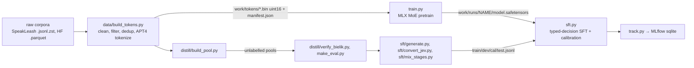

# Repository Guidelines

## Project Overview

Warda is a small, local, from-scratch decision model that guards what coding agents send out (commits, comments,
searches, external API calls). Given a data policy, a destination and content it returns a **typed** decision from a
closed set — `allow` / `redact` / `ask_user` / `block` — with calibrated confidence, not free-form text.

Status: research and data stage; no trained Warda model yet. The repo is **public**: never commit real personal data,
work data, client names or secrets — fixtures and datasets must be fictional.

## Run

Run everything from the repo root through `uv run`.

```bash
uv sync --locked                                   # .venv with locked runtime + dev deps
uv run python -m pretrain.quality.fetch_lid        # fastText LID model, sha256-checked (--variant ftz: small)
uv run pytest -q                                   # full suite (MLX tests skip where mlx is missing)
WARDA_SLOW=1 uv run pytest -q                      # also slow tests: MLX model loads, network
uv run pre-commit install                          # commit + pre-push hooks
uv run pre-commit run --all-files                  # all commit-stage checks
uv run pre-commit run --hook-stage pre-push --all-files   # pytest + CodeQL
```

Pipelines (see `pretrain/README.md` for full flags and results):

```bash
uv run python pretrain/data/build_tokens.py --download --download-only
uv run python pretrain/data/build_tokens.py
uv run python pretrain/sft/generate.py
uv run python pretrain/train.py --name s126m-1b --tokens 1e9 ...      # --resume to continue
uv run python pretrain/sft.py --base s126m-1b --name s126m-1b-sft --epochs 6
uv run python -m pretrain.harness.pii_gen generate --hours 7.5 --workers 16
uv run python -m pretrain.harness.pii_gen build
uv run python -m pretrain.quality.app --items pretrain/work/quality/items.jsonl --labeller <name> --port 8765
uv run mlflow ui --backend-store-uri sqlite:///pretrain/work/mlflow.db --port 5000
uv run python scripts/issues_sync.py lint          # also covered by pytest
uv run python scripts/issues_sync.py sync --dry-run
```

Dependencies: edit `pyproject.toml` or use `uv add` / `uv remove`; commit `uv.lock` (pre-commit runs `uv-lock --check`).

## Layout

- `warda/` — product code: `guard/` (detectors and redaction), `service/` (decision service), `hooks/` (agent
  integrations), `bench/` (evaluation harness), `label/` (labelling app), `schema.py` (shared literals and records),
  `cli.py` (CLI entry point, P2-06). Later phases fill the subpackages.
- `pretrain/` — research: scratch-model experiments and dataset tooling (table below).
- `data/` — committed synthetic datasets (later phases).
- `docs/` — plans, ADRs, gate records and the task catalogue (`docs/issues/`).
- `pretrain/work/` — **gitignored** artefacts: tokens, runs, SFT splits, pools, caches, models, `mlflow.db`.

| Path | Purpose |
|---|---|
| `pretrain/` | Model (`model.py`), pretraining (`train.py`), SFT (`sft.py`), prompts (`prompt.py`), MLflow mirror (`track.py`) |
| `pretrain/data/` | Corpus download → token bins (`build_tokens.py`) |
| `pretrain/sft/` | Decision-data generation, Jev conversion, stage mixing |
| `pretrain/distill/` | Bielik-teacher distillation pools, verification, eval filtering, spot-check export |
| `pretrain/harness/` | Synthetic PII/disclosure dataset generator |
| `pretrain/quality/` | Text-quality labelling: sampling, features, Starlette app, `static/` UI (Biome-checked) |
| `scripts/` | `issues_sync.py` (task catalogue ↔ GitHub), `codeql-scan.sh` |
| `codeql/python-models/` | CodeQL model marking Starlette `Route` request data as remote input |

## Data formats

**Decision item JSONL** — one item per line, shared by `pretrain/sft/generate.py`, `pretrain/sft/convert_jev.py`,
`pretrain/distill/*` and `pretrain/harness/pii_gen.py build`, consumed by `sft.py`. Fields: `id`, `state`,
`question`, `options`, `gold`, `type`, `family`, `template_id`, `case_id`, `language`, `split`, `label_method`,
`source`, `license`; harness items add `question_id`, `category`, `policy`, `destination`, `action`; `target` and
other metadata are optional. The closed vocabularies behind the fields (actions, categories, destination classes,
destinations, channels) live in `warda/schema.py`.

## Rules

- No real personal data, no work data, no secrets in prompts or code — the repo is public; fixtures and datasets
  must be fictional.
- One task = one branch and worktree from `main`, named `<issue-id>-<slug>` (e.g. `P1-01-tier1-detectors`).
- Small PRs; tests pass before merge.
- Agents propose, humans decide on gold labels.

## Hardware

- New scripts must have a CPU small-sample flag (`--limit`, `--hours 0.05`, ...); strong hardware is optional.
  Not yet true everywhere: `data/build_tokens.py`, `quality/enrich.py` and `quality/sample.py` have none — P1-06
  audits every `__main__` script and adds them.
- MLX training is Apple-silicon-only until a training port is separately scoped; non-ML tooling stays installable
  and testable on ordinary Linux/Windows laptops (MLX deps are platform-marked; tests skip MLX by capability).

## Architecture & Data Flow

Python 3.12, MLX on Apple Silicon (no CUDA/device selection). Main pipeline:



Side workflows:

- **Harness PII generator** (`pretrain/harness/pii_gen.py`): seeded fictional PII cases via local LLMs (LM Studio
  `:1235`, omlx `:8000`, OpenAI-compatible), two blind verification passes, then policy/destination decision items.
  `generate` appends resumably to `work/harness_pii/raw_cases.jsonl`; `build` writes item splits + manifest.
- **Quality labelling** (`pretrain/quality/`): `sample.py` → StyloMetrix worker (separate Python 3.11 venv, GPL) →
  `enrich.py` (+`textstats.py`, fastText LID, scratch-model NLL) → `items.jsonl` + `features.parquet` → Starlette app
  (`app.py`, SQLite label history) → `export_labels.py`.

Key contracts:

- **Decision JSONL record**: fields listed under [Data formats](#data-formats). Shared by `sft/generate.py`,
  `sft/convert_jev.py`, `distill/*`, `harness/pii_gen.py build`, consumed by `sft.py`.
- **Prompt format**: `pretrain/prompt.py` renders Polish/English chat prompts (other languages fall back to English)
  and `letter_ids`. `sft.py` depends on the exact option-line formatting — change both together.
- **Token bins**: each document framed with one BOS and one EOS; tokenize with `add_special_tokens=False`.
- `sft.py` averages predictions over canonical and reversed option orders; calibration is fit on `cal`, evaluated on
  `test`. Readout `pointer` (default) vs `letter` (did not train at this scale).
- Model (`pretrain/model.py`): decoder MoE — tied embeddings, GQA + RoPE, top-k experts + shared expert, router
  balance loss/bias; bf16 forward/backward with fp32 masters. `Config()` defaults are what `train.py` uses.

## Code Conventions & Common Patterns

- **Formatting/lint**: Ruff (line 120, py312), rules `E,W,F,I,B,UP,SIM,C4,PIE,RUF,PERF,PL,S,N,T20`. `print` (T201) and
  non-crypto `random` (S311) are banned by default — allowed only via **per-file ignores with a reason comment** in
  `pyproject.toml`. Adding a new CLI module that prints/samples means adding its own per-file-ignore entry.
- **Typing**: mypy over `pretrain`, `scripts` and `warda` with `check_untyped_defs`, `warn_unused_ignores`. Annotate
  function signatures; use `TypedDict`/dataclasses for records.
- **CLIs**: `argparse` + `main()` + `if __name__ == "__main__":`. Status via `print(..., flush=True)`; data/distill
  stages also append log files. Fail fast with standard exceptions / `SystemExit` on missing artefacts.
- **Paths/config**: module-level constants rooted at `pretrain/work/...`; CLI flags override. Some scripts adjust
  `sys.path` for repo-root imports (hence `E402` ignores).
- **Determinism**: always seed — `random.Random(seed)`, `np.random.default_rng(seed)`, MLX seed in model init. Generators
  must stay rerunnable; long jobs are resumable (skip done ids, append JSONL, atomic writes).
- **Lazy heavy imports**: import MLX/fastText inside functions (`PLC0415` ignored) so non-ML commands stay importable.
- **Dependency injection**: light; e.g. `create_app(items_path, db_path, labeller)` closes over data/DB; `sft.py` injects
  a small `Pointer` readout. Otherwise module constants, no global framework.
- **Async**: only in the Starlette quality app (async route handlers). Treat request data as untrusted (CodeQL scans it).
- **Language**: Polish is central to data, prompts and heuristics; don't assume non-Polish input is Polish. Keep each
  doc's existing language (`pretrain/HARNESS_DECIDER_PLAN.md` is Polish; the rest is English). Add new Polish words
  that trip codespell to `[tool.codespell] ignore-words-list`.
- **Frontend**: `pretrain/quality/static/` — Biome recommended rules, 2-space indent, 120 cols.
- **Markdown**: markdownlint, MD013 at 120 cols (tables/code exempt), MD060 disabled.

## Important Files

- `pyproject.toml` — deps (`tool.uv.package = false`, not installable), pytest, Ruff (with reasoned ignores), mypy,
  codespell.
- `.pre-commit-config.yaml` — pinned hooks; blocks commits to `main`, files > 500 KB, secrets, lockfile drift.
- `.gitleaks.toml` — allowlists only `pretrain/harness/pii_gen.py` (synthetic credential-shaped strings).
- `.github/workflows/tests.yml` — CI on push to `main` only (macOS 15 arm64): `uv sync --locked`,
  `fetch_lid --variant ftz`, `HF_HUB_OFFLINE=1 uv run --locked pytest -q`.
- `.github/PULL_REQUEST_TEMPLATE/{feature,data,experiment,docs}.md` — PR templates.
- `pretrain/README.md` — pipeline commands, data sources/licences, results. `FINDINGS.md` — decisions and findings.
- `pretrain/QUALITY_CLASSIFIER.md`, `pretrain/HARNESS_DECIDER_PLAN.md` — design / team plan.
- `docs/issues/README.md` — catalogue schema, labels, board fields.

## Runtime/Tooling Preferences

- **uv only**, Python `==3.12.*` (uv fetches it). Never `pip install` into `.venv`; always `uv run`.
- Apple Silicon + MLX/MLX-LM for training; Transformers/HF Hub for tokenizers (Bielik
  `speakleash/Bielik-1.5B-v3.0-Instruct`, APT4 cached in `work/cache/`).
- External assets not in git: fastText `pretrain/work/quality/models/lid.176.bin` (or `.ftz`; fetch with
  `uv run python -m pretrain.quality.fetch_lid`, checksums pinned in `pretrain/quality/fetch_lid.py`), corpora,
  weights, local LLM servers for `pii_gen`, StyloMetrix venv (`pretrain/quality/setup_stylometrix.sh` →
  `pretrain/.venv-stylometrix`).
- CodeQL CLI (`brew install --cask codeql`) required by the pre-push hook; emergency skip: `SKIP=codeql git push`.
- `scripts/issues_sync.py` shells out to an authenticated `gh` CLI.

## Testing & QA

- pytest 9; root `conftest.py` loads the pytester plugin and skips `@pytest.mark.slow` tests unless `WARDA_SLOW=1`,
  `@pytest.mark.requires_mlx` tests where `mlx` is absent (no `requires_mlx` tests exist yet) and
  `@pytest.mark.requires_lid` tests where the fastText LID model is missing — except under CI (`CI` set), where
  `requires_lid` tests run and fail instead; `testpaths = ["pretrain", "scripts", "warda"]`, `pythonpath = ["."]`.
- Tests live in `<package>/tests/test_*.py`: plain `test_*` functions with `assert`, `pytest.mark.parametrize`,
  `tmp_path`, `monkeypatch`, local fakes (e.g. fake `gh` calls). No test classes.
- Covered: `warda/schema` and the collection gates, `harness/pii_gen`, `quality/{textstats,app,fetch_lid}`, `sft`
  Englishization, `scripts/issues_sync`. Not covered: `model`, `train`, `sft.py`, `prompt`, `track`, `data/`,
  `distill/` — verify those with a real smoke run.
- Mark tests that call the real LID model `@pytest.mark.requires_lid`. PR templates mention slow tests via
  `WARDA_SLOW=1`.
- No coverage tooling or threshold; expectation is tests for new behavior plus the manual test in the PR.

```bash
uv run pytest -q pretrain/quality/tests/test_textstats.py
uv run pytest -q pretrain/harness/tests/test_pii_gen.py::test_generated_identifiers_pass_their_checksums
```

## Workflow & Docs

- Squash-merge small PRs with `Closes #N`; branch and worktree naming: see Rules.
- Commit prefixes: `feat:`, `fix:`, `docs:`, `test:`, `refactor:`, `build:`, `chore:` (body: `Part of P1-01`).
- Issue files: `docs/issues/P<phase>-<nn>-<slug>.md`, TOML frontmatter between `+++` (`id`, `title`, `labels`,
  `milestone`, `depends_on`, `estimate_hours`, `hardware`, `github_issue = 0` for new), seven sections in order:
  Context, Scope, Deliverables, Definition of done, Automated tests, Documentation, Manual test (human, before the PR).
  Don't write `## Dependencies` / `## Team / hardware / estimate` — sync renders them.
- Update in the same PR: files listed in the issue's Documentation section; README Contents for new top-level
  dirs/entry points; this `AGENTS.md` for commands, layout, formats or rules; dataset cards/manifests for data changes.
