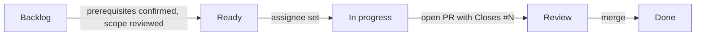

# Contributing to Warda

Warda is built by a volunteer team following `pretrain/HARNESS_DECIDER_PLAN.md`. This file says how work moves from a
task to a merged PR, and what you must keep up to date along the way. Coding agents follow the same rules (see
`AGENTS.md` once P0-01 lands).

The repository is public. Never commit or paste into issues, PRs or prompts any real personal data, work data,
client names or secrets. Every example, fixture and dataset is fictional.

## Where the work is

| What | Where | Source of truth |
|---|---|---|
| Tasks | GitHub issues, one per file in [`docs/issues/`](docs/issues/README.md) | the markdown file |
| Board | [Warda project](https://github.com/users/pawelkiszczak/projects/2) | Status: people; other fields: the file |
| Phases | Milestones `Phase 0 …` to `Phase 5 …` | `scripts/issues_sync.py` |
| Decisions | `docs/decisions/ADR-NNNN-*.md` | the ADR |
| Gate outcomes | `docs/gates/GATEN.md` | the gate record |

Labels on every task: `phase:N`, one `team:*`, one `type:*`, optional `gate:N`, and `hardware:*` for the compute it
needs (`laptop` = any 8–16 GB laptop, `strong` = shared big machine or rented GPU, `cloud` = rented/free cloud GPU).
Even `strong` tasks have a small CPU run that must work on a laptop.

Board views: **Board** (columns by Status), **All tasks**, **Ready on a laptop** (good first pick), **Needs strong
compute**.

## Setup

```bash
uv sync --locked
uv run pre-commit install          # commit + pre-push hooks; pre-push runs pytest and CodeQL
uv run pytest -q
```

The quality tests need the fastText language-ID model and CodeQL needs its CLI; both are described in `README.md`
under "Quick start" and "Development checks".

## Workflow



1. **Pick** a card in *Ready*. Check its `hardware:*` label. Set yourself as the GitHub assignee, then move the card
   to *In progress* — never move an unassigned card; team labels are not ownership. One person per card; if two
   people want it, split the task (new file) first.
2. **Branch** from `main` as `<issue-id>-<slug>`, e.g. `P1-01-tier1-detectors`. Direct commits to `main` are blocked
   by a hook. For agents or parallel work use a worktree: `git worktree add ../warda-P1-01 -b P1-01-tier1-detectors`.
3. **Commit** in small steps with a type prefix as in the history: `feat:`, `fix:`, `docs:`, `test:`, `refactor:`,
   `build:`, `chore:`. Put the issue id in the body when it helps (`Part of P1-01`).
4. **Open a PR** early (draft is fine) with `Closes #N` and the right template (below). Move the card to *Review*
   when it is ready for review.
5. **Review**: one approval from the owning team or the coordinator. The author runs the issue's manual test and
   pastes the result; the reviewer reruns it when the change touches behaviour they can try locally.
6. **Merge** with squash; delete the branch. The issue closes through `Closes #N`; the card goes to *Done*.

Blocked? Comment on the issue with what blocks you and by whom, keep the card where it is, and raise it at the
weekly meeting.

## Keep everything up to date

A PR is not done until these match the code. Reviewers check them.

### Docs

- Change the files named in the issue's **Documentation** section in the same PR.
- New top-level directory or entry point → `README.md` "Contents".
- New or changed command, layout, data format or rule → `AGENTS.md`.
- A decision (tool, threshold, scope, process) → a new or updated ADR in `docs/decisions/`.
- New dataset or dataset version → its dataset card and the counts in the manifest.

### Issues

- `docs/issues/*.md` is the source of truth. **Do not edit issue bodies, titles, labels or milestones on GitHub**:
  the next sync overwrites them. Comments are for discussion and progress.
- Scope changed while working? Edit the task file in the same PR (Scope, Deliverables, Definition of done, tests).
- New task: copy a file, use the next free id in the phase (`P1-12`), set `github_issue = 0`, keep the seven
  sections, run `uv run python scripts/issues_sync.py lint`.
- Dropped task: close the issue as *not planned* with the reason, and delete the file in a PR (lint tells you if
  another task depends on it).
- Push the catalogue to GitHub **from the approved PR branch, right before merging** — `sync` writes new issue
  numbers into the files, and those must be committed on the branch because `main` is protected:

  ```bash
  uv run python scripts/issues_sync.py sync --dry-run    # check what changes
  uv run python scripts/issues_sync.py sync              # labels, milestones, issues, project cards
  git commit -am "docs: sync task catalogue"             # only if github_issue numbers changed
  ```

### Project board

- Move **Status** yourself. `sync` only puts new cards in *Backlog*; it never moves a card after that.
- *Backlog* → *Ready* only when the prerequisites are satisfied, not merely when dependency issues are closed: every
  dependency is merged, a gate dependency has a recorded PASS in `docs/gates/`, and someone other than the future
  assignee has reviewed the scope against what was actually delivered. Raise it at the weekly meeting if unsure.
- *Ready* → *In progress* requires an assignee; *In progress* → *Review* when the PR is ready for review.
- **Phase, Team, Hardware, Estimate** come from the task file; change the file, not the board.
- Closed issues and merged PRs should land in *Done* through the project's built-in workflows ("Item closed",
  "Pull request merged"); if a card is left behind, move it.

### Pull requests

- PR description follows its template; the manual-test result is pasted, not promised.
- Keep PRs small (one task, ideally under ~400 changed lines excluding data). Split otherwise.

## PR templates

The default template opens automatically. For a specific kind of change, pick one with
`gh pr create --template <name>.md` or by adding `?template=<name>.md` to the compare URL:

| Template | Use for |
|---|---|
| `feature.md` | code in `warda/`, `pretrain/`, `scripts/`: guard, service, hooks, CLI, tools |
| `data.md` | synthetic or hand-written data, labelling rounds, policies, corpus changes |
| `experiment.md` | training runs, sweeps, benchmarks, comparisons |
| `docs.md` | docs, ADRs, gate records, team docs |

## Checks before you push

```bash
uv run pre-commit run --all-files
uv run pytest -q
```

The pre-push hook runs pytest and CodeQL. Skip only CodeQL, only in an emergency: `SKIP=codeql git push`.
