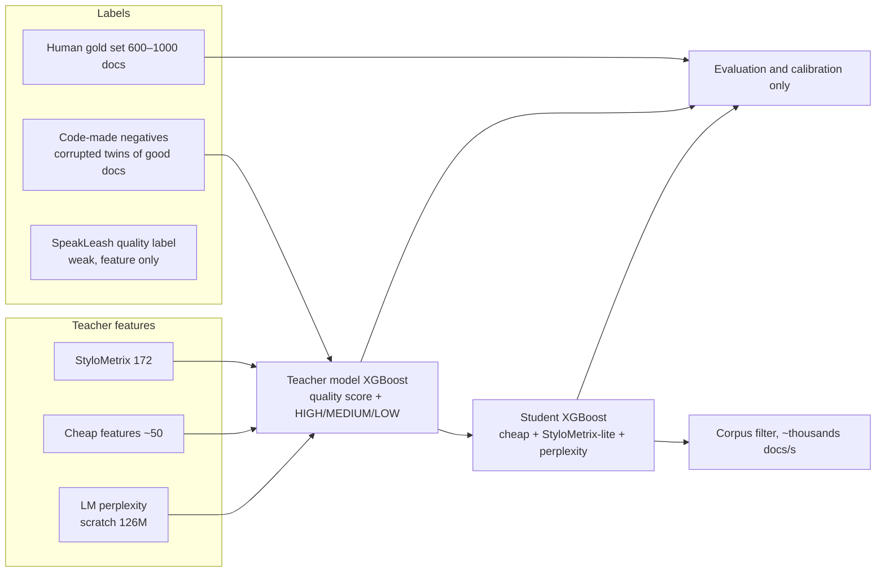

# Design: Polish text-quality classifier

Status: **design; not built.** Replaces the current quality filter in `data/build_tokens.py` (XGBoost on ~50 plain-Python
features trained to imitate SpeakLeash's per-document `quality` label: accuracy 0.813, macro-F1 0.814, HIGH-F1 0.785).
Intended for the large-corpus pretraining stage.

## Why change the current filter

- **It imitates SpeakLeash's own classifier.** Its labels are another model's output, so we can't measure true quality,
  only agreement with SpeakLeash.
- **It sees no syntax or morphology.** Bielik's v3 classifier, which reached 95% accuracy on 44k hand-labelled
  documents, relied on StyloMetrix-style morphosyntactic features: OOVs, case/tense/mood diversity, dependency depth.
- **No human ground truth and no calibration.** The 0.9 vs 0.5 thresholds were arbitrary.

## What was verified on this Mac (feasibility spike, 2026-10-10)

- **StyloMetrix 0.1.9.1 + `pl_nask` 0.0.7** (HerBERT-based spaCy pipeline: tagger, morphologizer, parser, NER,
  Morfeusz) run on Python 3.11. Five fixes were needed:
  1. `numpy<2`.
  2. `spacy-transformers` 1.3.x.
  3. `morfeusz2==1.99.14` (1.99.15 breaks).
  4. `pl_nask` installed with `--no-deps`.
  5. A one-line patch: `pl_nask/morf.py` on macOS imports an obsolete pexpect wrapper around Morfeusz CLI binaries;
     the real `morfeusz2` wheel (universal2) works.
- **Version caveat:** `pl_nask` was built for spaCy 3.5 and runs under 3.7.2 with a warning; check metric values
  before trusting them.
- **Output:** **172 metrics**: grammatical forms 24, inflection 64, lexical 34 (incl. `L_ERROR` common language
  errors), syntactic 18, psycholinguistic 12, descriptive 10, graphical 7 (emoji, mentions, hashtags, links, caps),
  punctuation 3.
- **Speed:** **5.5 documents/s per process** on CPU (50 real passages, ~1,340 characters each). With ~8–10 processes,
  an estimated 40–50 documents/s (≈4M documents/day): fine for training sets, **too slow for corpus-wide scoring**
  (the large-corpus stage needs to score ~20–30M candidate documents).
- **Licence:** StyloMetrix and `pl_nask` are GPL-3.0, so they run in their own virtual environment as a separate
  process that reads and writes JSONL. Our Apache code never imports them; only numeric features cross the boundary
  [INFERENCE: not legal advice].

## Architecture: an expensive teacher, a fast student

### 1. What "high quality" means (fixed before labelling)

Use the Bielik annotation scheme with explicit definitions, shared by human labellers and the rubric below.

- **HIGH:** coherent, complete, correct Polish; informative or literary; little boilerplate.
- **MEDIUM:** understandable but flawed: typos, colloquial, partly boilerplate, fragmentary.
- **LOW:** spam, lists of links or keywords, broken encoding or OCR, machine-generated or garbled text, loops, mostly
  navigation, menus or code.

### 2. Labels and rubric

Three label sources, none sufficient alone:

| Source | Size | Use | Why |
|---|---:|---|---|
| **Human gold set** (stratified by source × current P(HIGH) band) | 600–1,000 docs (300 minimum) | **Evaluation and calibration only, never training** | The only ground truth |
| **Code-made negatives** (twins) | 20–30k pairs | Training: LOW / MEDIUM with a known label | The twin principle: one controlled change → known label. Corruptions: shuffled sentences, injected typos, stripped diacritics, OCR-like noise, keyword stuffing, truncation, repeated paragraphs, navigation/boilerplate prepended, machine-translated round-trip. Both twins stay in one split |
| **SpeakLeash `quality`** | all SL docs | Feature and agreement check, not the target | It is a classifier's output |

**Labelling rubric** — questions written and fixed in advance, one document per request, all questions about the same
state; usable by human labellers and by any future local judge:

- "Czy tekst jest napisany poprawną polszczyzną, bez licznych błędów i zniekształceń?"
- "Czy tekst jest spójny i zrozumiały jako całość?"
- "Czy tekst to głównie spam, reklama, lista linków lub słów kluczowych, menu albo fragmenty techniczne?"
- "Czy tekst wygląda na wygenerowany maszynowo, automatycznie przetłumaczony lub zapętlony?"
- "Czy tekst jest urwany lub złożony z niepowiązanych fragmentów?"
- "Jaka jest wartość informacyjna tekstu?" (0 brak – 3 wysoka; FineWeb-Edu-style rubric)
- "Ogólna jakość tekstu" with the three definitions above (LOW / MEDIUM / HIGH as levels)

Target = the overall-quality level. The other answers become auxiliary signals of the teacher, and their agreement
with the overall answer is a sanity check.

Labelling rules:

- Questions are written and **fixed before labelling**.
- Composite judgements are split into primitives; the classifier combines them.

**Label supply.** The planned cheap rubric labels from an external decision model were cut with the external-project
tie-in. Until a replacement exists, the documented fallback stands: the teacher trains on code-made negatives plus
human labels from a training split only (§4); decision 2 covers the sizing.

### 3. Features

- **StyloMetrix (172).** The most relevant groups for quality:
  - `L_ERROR`, lexical density and TTR-type metrics.
  - Inflection / case / tense / mood diversity.
  - Syntactic sentence types (`SY_S_*`), descriptive.
  - Graphical (`GR_LINK`, `GR_HASH`, `GR_MENTION`, `GR_EMOJI`, `GR_UPPER`), punctuation.
- **Cheap features (~50, existing):** OOV rate against the plwiki word list, diacritics ratio, short/duplicate line
  ratios, symbol/word ratio, looping, U+FFFD, average lengths, hapax ratio…
- **LM perplexity (new):** token NLL mean / p90 / std from the 126M scratch model (`pretrain/model.py`) on the first
  512 tokens.
  - CCNet/FineWeb use perplexity because it catches garbled, machine-translated and boilerplate text.
  - Prefill-only on the Mac GPU, so it scales to the corpus [INFERENCE: throughput to measure].
  - Caveat: perplexity also rewards *familiar* text. Kept as a feature, never a sole filter.
- **Metadata (feature):** source, length, SpeakLeash `quality` when present.

**Loop and language signals (implemented in `pretrain/quality/textstats.py`).** The rationale, condensed from the
research note this design grew out of:

- **Repetition.** `loop_metrics` implements the Gopher/MassiveText cutoffs: duplicate line/paragraph fractions 0.30,
  their character fractions 0.20, most-frequent 2–4-gram character fractions 0.20/0.18/0.16, repeated 5–10-gram
  character fractions 0.15–0.10. FineWeb tested fifty-plus candidate statistics with training ablations and tightened
  the duplicated-line character share to 0.10; FineWeb-2 disables paragraph filters when extraction doesn't preserve
  paragraph boundaries ([Gopher](https://arxiv.org/abs/2112.11446), [FineWeb](https://arxiv.org/abs/2406.17557),
  [FineWeb-2](https://arxiv.org/abs/2506.20920)). `loop_score` averages each Gopher-derived signal normalized by its
  published cutoff (capped at 1) — a review ranking signal, not an automatic reject threshold; compression ratio
  (zlib) and a suffix-automaton longest repeated substring round it out. Raw features stay visible so a human can
  judge legitimate repetitions; RedPajama-V2 makes the same point by releasing 40+ per-document signals rather than
  verdicts ([repo](https://github.com/togethercomputer/RedPajama-Data)).
- **Language.** Document-level LID is not enough for mixed pages. Full fastText `lid.176.bin` was chosen over the
  compressed `lid.176.ftz` (which mislabels short Polish text) for supported Polish, fast CPU inference and a modest
  126 MB download ([fastText](https://fasttext.cc/docs/en/language-identification.html)). LID runs per line (lines
  over 400 chars split at sentence ends); a unit is labelled only at ≥20 letters and confidence ≥0.5; the low-level
  `model.f.predict` binding is required for NumPy 2 compatibility. FineWeb-2's data-driven per-language cutoffs
  ([GlotLID](https://github.com/cisnlp/GlotLID)) are the reference for later per-language thresholds instead of
  copying English-centric constants.
- **Keep the signals separate.** Raw features, per-line language shares, script shares and highlight spans make
  errors visible and let future human labels calibrate a classifier instead of hard-coding cutoffs; code-switch
  research points the same way ([MaskLID](https://arxiv.org/abs/2406.06263)). Polish diacritic-word and stopword cues
  improve recall on short segments but are heuristics — they never mask the LID shares.

### 4. Models

- **Teacher:** XGBoost `multi:softprob` (HIGH / MEDIUM / LOW) with Bielik v3 hyperparameters (250 trees, depth 8,
  lr 0.08, subsample 0.75, colsample 0.8, α 0.2, λ 0.5).
  - Training target: the §2 fallback — human labels from the training split plus code-made negatives.
  - Calibration: temperature fitted on a calibration split.
- **Student:**
  - **What it sees:** cheap features + **StyloMetrix-lite** (the ~30–40 most important StyloMetrix metrics by SHAP,
    recomputed with `morfeusz2` directly, without the transformer pipeline) + perplexity.
  - **Target:** the teacher's soft probabilities. **Speed target:** ≥1,000 docs/s on 12 cores.
- **Keep rule for the corpus:** chosen on the human calibration half, not by a fixed 0.9:
  - the lowest P(HIGH) threshold whose kept set has ≥90% human-HIGH-or-MEDIUM and ≤3% human-LOW, and
  - a separate cap so that no source exceeds its quota.

### 5. Evaluation (human gold set; split 50/50 into calibration / test, scored once)

- **Per system:**
  - macro-F1, HIGH-F1, LOW recall.
  - AUROC of HIGH-vs-rest.
  - **Precision of kept documents at the chosen threshold** (the number that matters for pretraining), plus kept volume.
- **Baselines on the same items:**
  1. The SpeakLeash label.
  2. Our current filter.
  3. Cheap-only XGBoost.
  4. StyloMetrix-only XGBoost.
  5. Teacher (all features).
  6. Student.
- **Ablations:** remove one feature group at a time; SHAP summary per group.
- **Fidelity checks:**
  - StyloMetrix-lite vs full (per-metric correlation ≥0.9 for the kept metrics).
  - Student vs teacher (agreement ≥0.9 on HIGH vs not-HIGH).
- **Downstream check (optional, ~7 h):** pretrain 126M for 300M tokens on (a) top-scored vs (b) randomly sampled
  documents from the same pool. Compare validation loss on plwiki / literature / law, and a short decision fine-tune.
  This is the only test of whether "high quality" helps the model.

### 6. Code layout (to implement later)

| File | What |
|---|---|
| `pretrain/quality/stylometrix_worker.py` | Runs in its own venv (`.venv-stylometrix`, Python 3.11, GPL deps); JSONL in → 172 metrics out; multi-process |
| `pretrain/quality/corrupt.py` | Code-made negative twins with known labels |
| `pretrain/quality/features.py` | Cheap features (moved from `build_tokens.py`), StyloMetrix-lite via `morfeusz2`, perplexity via MLX |
| `pretrain/quality/train.py` | Teacher → student; calibration; SHAP; report |
| `pretrain/quality/export_gold.py` | Stratified human-labelling sheet (Markdown + CSV) |
| `data/build_tokens.py` | Calls the student instead of the current XGBoost; threshold from the calibration report |

### 7. Time on this Mac

| Step | Time |
|---|---:|
| Environment + scripts | ~0.5 d |
| Sample 30k docs (stratified by source) + StyloMetrix on them (~8 processes) | ~0.5 h |
| Code-made negatives | minutes |
| Human gold set (you or annotators) | 600 docs ≈ 5–6 h of reading; 300 minimum |
| Teacher, student, evaluation, ablations | ~0.5 d |
| Downstream 126M check (optional) | ~7 h |
| **Total machine time** | **~1–2 days**, plus human labelling |

### 8. Risks

- **Label supply:** training labels come only from the human training split and code-made negatives. The negatives
  cover known corruption patterns, so watch for organic LOW they don't represent.
- **StyloMetrix:** version drift (spaCy 3.5 model under 3.7), GPL licence (process isolation), and speed (teacher-only).
- **Perplexity bias:** rewards text similar to the scorer's training data (our corpus is web-heavy); monitor the
  source mix of kept documents.
- **Genre bias:** forum and subtitle text is often "MEDIUM" by style yet valuable for Polish coverage. Keep per-source
  quotas so the filter cannot remove a whole register.
- **Distribution shift:** labelling 30k docs from a 20–30M candidate pool; stratify by source and by current
  P(HIGH) band.

### 9. Decisions needed

1. Who labels the human gold set, and how many documents (300 minimum, 600–1,000 recommended)?
2. How to obtain enough labelled training documents now that the cheap rubric-labelling option is cut: human-only
   volume, negatives-first, or something else — and how large the human-labelled training split must be.
3. Run the downstream 126M check (~7 h)? It is the only direct evidence that the filter helps pretraining.
